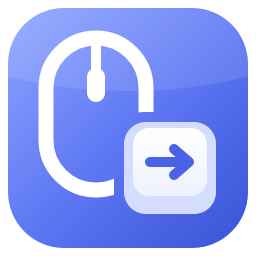

<p align="center"></p>

# mouse-kb-remap

A lightweight, open-source, brand-agnostic remapper for mice and keyboards. Think the
per-game profiles, macros and turbo of Logitech G HUB or Razer Synapse, but in one small
app that works with **any** mouse or keyboard.


## What it does

- **Per-app profiles.** A profile activates automatically while its app's window is focused
  (e.g. `GenshinImpact.exe`) and switches back when you alt-tab away. The **Default**
  profile applies everywhere else, and other profiles inherit its bindings.
- **Remap any button or key** to:
  - a **key or combo** (Ctrl + C, Alt + Tab, Win + Shift + S…), with one-click presets
  - a **mouse button** or scroll step, including horizontal scroll (wheel tilt)
  - a **macro**: recorded or hand-built keys, clicks, delays and text, played once, a set
    number of times, while held, or toggled on/off
  - **turbo** / **repeat on hold** with your own timing: press interval, hold time and an
    optional "start repeating after" delay, while held or toggled
  - **text** to type (any language), **launch** a program, file or URL, **media keys**
  - a **shift layer** button (like G-Shift / Hypershift): hold it for a second set of
    bindings on every other button and key
  - a **sensitivity clutch** ("sniper" button): lower pointer speed while held
  - **off**
- **Games-friendly output.** Keys are sent as scan codes, which most games read, and timed
  output (turbo, macros) runs on a precise timer thread (typically within 1 ms).
- **Safe by design.** Remaps never apply while this app's window is focused, and focusing it
  stops any running macro or turbo, so a bad binding can't lock you out.
- **Tray icon, start with Windows** (optionally as administrator, for games that run
  elevated), **import / export** of profiles with their macros.
- **Light and dark themes.** The dark theme is Discord-style charcoal, not pitch black.


## Status

| Area | State |
| --- | --- |
| Windows engine (hooks, focus tracking, `SendInput`, macros, turbo) | Working; timing, combos, macros, shift layer and sensitivity tested end-to-end on Windows 11 |
| UI (profiles, mouse and keyboard diagrams, macro editor, settings) | Working |
| Linux engine (evdev + uinput, X11 focus tracking) | Experimental: builds and passes unit tests, not yet tried on real hardware |
| macOS engine | Not yet (the UI runs in preview mode) |

## Quick start (Windows)

- **Prebuilt:** grab `mouse-kb-remap-windows-x64.zip` from
  [Releases](https://github.com/jonathant09/mouse-kb-remap/releases), unzip, run `start.bat`.
- **From source:** install Rust from <https://rustup.rs>, then:

  ```powershell
  git clone https://github.com/jonathant09/mouse-kb-remap
  cd mouse-kb-remap
  .\start.bat          # builds into dist\ on first run, then launches
  .\start.bat admin    # run as administrator (for games that run elevated)
  .\start.bat build    # rebuild after pulling changes
  ```

Settings are saved to `%APPDATA%\mouse-kb-remap\config\config.json`.

> **Games that run as admin** (Genshin Impact does, for its anti-cheat) only accept input
> from programs that are also elevated. Use `start.bat admin`, or *Settings → Start with
> Windows → On, as administrator*.

## Documentation

- [Getting started](docs/getting-started.md)
- [User guide](docs/user-guide.md): profiles, actions, shift layer, tray, settings
- [Macros & turbo](docs/macros.md): recording, editing, playback modes, timing tips
- [Configuration](docs/configuration.md): `config.json` format and all key ids
- [Troubleshooting](docs/troubleshooting.md): games, admin rights, anti-cheat, other remappers, Linux permissions
- [Architecture](docs/architecture.md): how the engine and UI fit together
- [Building & releasing](docs/building.md): toolchain, tests, CI, icon, cutting a release

## Project layout

```
start.bat            Launcher: run / build / run as admin
assets/              App icon (SVG source, PNGs, .ico)
tools/               render-icon.mjs: regenerates the icon files
docs/                Documentation
.github/workflows/   Windows + Linux build, test and release CI
src/
  main.rs            Entry point: single instance, --tray flag
  app.rs             UI wiring: state, Slint callbacks, refresh()
  config.rs          Profiles, bindings, macros, JSON load/save, import/export
  keys.rs            Key table (TKL + number pad + extra keys), presets
  system.rs          Single instance, start with Windows, open files/URLs
  log.rs             Log file next to config.json
  engine/
    mod.rs           Engine API, profile compilation, recording → macro steps
    dispatch.rs      What one input event does (shared by all backends)
    player.rs        Timed playback: macros, turbo, text, launch
    windows.rs       Low-level hooks, focus tracking, SendInput (Windows)
    linux.rs         evdev grab + uinput output, X11 focus (Linux, experimental)
    fallback.rs      No-op engine so the UI runs on other OSes
ui/
  app.slint          Main window, status bar, tray icon
  store.slint        Global state shared with Rust
  sidebar.slint      Profiles, macros, settings, theme
  profile-view.slint Header + device canvas
  inspector.slint    Action editors (key, macro, turbo, …)
  macro-view.slint   Macro editor
  settings-view.slint Settings page
  mouse.slint        Generic mouse illustration with callouts
  keyboard.slint     Generic TKL / full-size keyboard
  controls.slint     Key capture box, modifier toggles
  widgets.slint      Buttons, chips, segmented control, fields, switch
  theme.slint        Colors, radii, type scale (light + dark)
```

## Roadmap

- [x] Tray icon + close-to-tray
- [x] Start with Windows, optionally elevated (Task Scheduler, one UAC prompt)
- [x] Macros: recording, editing, once / repeat / while held / toggle
- [x] Turbo and repeat-on-hold with custom timing
- [x] Modifier combos (Ctrl+C, Shift+F) as targets
- [x] Import / export profiles
- [x] Shift layer, sensitivity clutch, text, launch, media keys, wheel tilt
- [x] Linux backend (evdev + uinput), experimental
- [ ] Per-device bindings (tell two mice apart). Windows doesn't tell low-level hooks which
      device an event came from, so this needs a filter driver (e.g. Interception), which
      anti-cheats often block. Linux could do it with evdev; planned there first.
- [ ] Linux: try on real hardware, Wayland focus tracking (per compositor)
- [ ] macOS backend

## License

MIT
