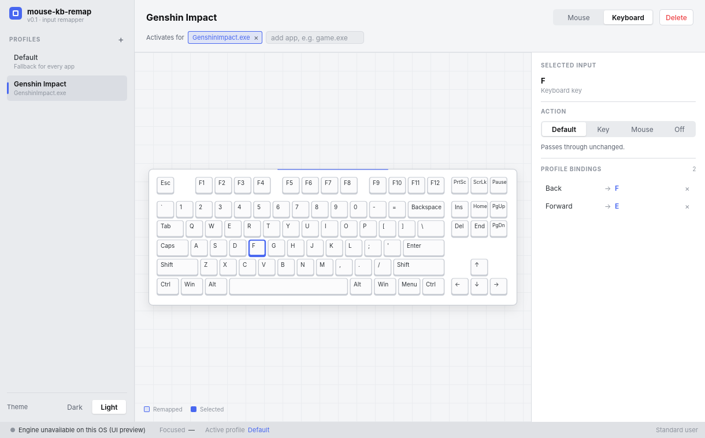

<p align="center"></p>

# mouse-kb-remap

A lightweight, open-source, brand-agnostic remapper for mice and keyboards. Think the
per-game profiles, macros and turbo of Logitech G HUB or Razer Synapse, but in one small
app that works with **any** mouse or keyboard.


## What it does

- **Per-app profiles.** A profile activates automatically while its app's window is focused
  (e.g. `GenshinImpact.exe`) and switches back when you alt-tab away. The **Default**
  profile applies everywhere else, and other profiles inherit its bindings. Match by exe
  name, full path or window title (with wildcards), optionally only while fullscreen, or
  pick a profile by hand with a hotkey.
- **Remap any button or key** to:
  - a **key or combo** (Ctrl + C, Alt + Tab, Win + Shift + S…), with one-click presets
  - a **mouse button** or scroll step, including horizontal scroll (wheel tilt)
  - a **macro**: recorded or hand-built keys, clicks, delays and text, played once, a set
    number of times, while held, or toggled on/off
  - **turbo** / **repeat on hold** with your own timing: press interval, hold time and an
    optional "start repeating after" delay, while held or toggled
  - **text** to type (any language), **launch** a program, file or URL, **media keys**
  - **layers** (like G-Shift / Hypershift): a shift layer plus layers 2 and 3, held or
    toggled, each a whole extra set of bindings
  - **tap / hold**: one action on a tap, another when held, a third on a double tap
    (Caps Lock: tap for Esc, hold for Ctrl)
  - **system actions**: lock the PC, mute the microphone, switch audio output, minimize,
    maximize, always on top, move the window to the next monitor, switch profile
  - a **sensitivity clutch** ("sniper" button): lower pointer speed while held
  - **mouse gestures**: hold a button, swipe up / down / left / right, let go
  - a **controller button**, trigger or stick direction of a virtual Xbox controller
    (Windows, with the free ViGEmBus driver the app offers to install; Linux, experimental)
  - **off**
- **Combos as triggers**: Ctrl + Back, Right click + Left click, Shift + Wheel… do
  something other than the button alone.
- **Game controllers**: Xbox, PlayStation (DualShock 4, DualSense, Edge), Switch (Pro, Joy-Cons),
  Steam Deck and Steam Controller, and any other gamepad: remap every button, trigger, d-pad and
  stick direction like any other input, and move the pointer with a stick, the gyro or the
  touchpad. Works alongside Steam.
- **Virtual controller** (Windows; Linux, experimental): play games that want a controller
  with a keyboard and mouse, or remap a controller for games: keys, mouse buttons and
  controller buttons press the buttons, triggers and sticks of a virtual Xbox controller,
  which copies your real controller's other inputs. **Mouse movement can move a stick**, and
  the real controller can be **hidden from games** (with HidHide on Windows, installed in one
  click), so they see only the remapped one. Plugged in only while a profile uses it.
- **Bindings for one device**: give a second mouse, a trackball or a controller its own
  bindings (keyboards too on Linux).
- **Macros** can move the pointer, press controller buttons and randomize their delays.
- **Games-friendly output.** Keys are sent as scan codes, which most games read, and timed
  output (turbo, macros) runs on a precise timer thread (typically within 1 ms).
- **Safe by design.** Remaps never apply while this app's window is focused, and focusing it
  stops any running macro or turbo, so a bad binding can't lock you out.
- **Tray icon, start with Windows** (optionally as administrator, for games that run
  elevated), **import / export** of profiles with their macros, **undo / redo**.
- **Hotkeys and command line**: pause, resume or switch profile from anywhere, or from
  scripts and Stream Deck (`mouse-kb-remap.exe --profile "Genshin Impact"`).
- **On-screen notifications** (optional) when the profile changes or a toggle flips.
- **Updates from inside the app**: check, then one click downloads, verifies and installs
  the new version and restarts.
- **Light and dark themes.** The dark theme is Discord-style charcoal, not pitch black.



## Installation

1. [Download the latest release](https://github.com/jonathant09/mouse-kb-remap/releases/latest):
   `mouse-kb-remap-<version>-windows-x64.zip`, or just `mouse-kb-remap.exe`.
2. Unzip it anywhere you keep apps, for example your Documents folder.
3. Run `mouse-kb-remap.exe`. Nothing else to install (Windows 10 and 11).

The exe isn't code-signed yet, so Windows SmartScreen may warn the first time: click
**More info → Run anyway**. Settings are saved to `%APPDATA%\mouse-kb-remap\config\`, so
replacing the exe with a newer version keeps them. To have it start when you sign in, use
*Settings → Start with Windows*.

> **Games that run as admin** (Genshin Impact does, for its anti-cheat) only accept input
> from programs that are also elevated. Use *Settings → Start with Windows → On, as
> administrator*, or right-click the exe → **Run as administrator**.

## Status

| Area | State |
| --- | --- |
| Windows engine (hooks, focus tracking, `SendInput`, macros, turbo) | Working; timing, combos, macros, layers, tap / hold, gestures, per-device bindings, hotkeys, system actions, notifications, the command line and updating tested end-to-end on Windows 11 |
| Controllers (XInput, PlayStation, Switch, Steam, other HID) | Report formats checked against SDL and unit-tested; reading tested on Windows 11 with no controller attached; not yet tried with real controllers |
| Virtual controller (ViGEmBus) | Working: output, turbo, tap / hold, macro steps, mouse → stick and copying a controller tested end-to-end on Windows 11 through XInput (a second virtual controller standing in for a real one); not yet tried in games |
| Hiding the real controller (HidHide) | Working: hiding while copying, giving it back on quit and after a crash tested end-to-end on Windows 11 with HidHide 1.5.230 (on the stand-in controller) |
| UI (profiles, mouse and keyboard diagrams, macro editor, settings) | Working |
| Linux engine (evdev + uinput; X11, sway, Hyprland and niri focus tracking) | Experimental: the virtual controller, mouse → stick, copying and hiding a controller tested end-to-end with uinput test devices, and focus tracking with a headless sway, in WSL 2; not yet tried on real hardware |
| macOS engine | Not yet (the UI runs in preview mode) |

## Input latency

Measured on Windows 11 (release build, 1,000 samples per row): time from an input being
sent until a hook further down the chain receives it, without and with mouse-kb-remap.

| | Median | p95 | p99 | Max |
| --- | --- | --- | --- | --- |
| Key, without the app | 0.042 ms | 0.12 ms | 0.19 ms | 0.67 ms |
| Key, with the app (not remapped) | 0.067 ms | 0.22 ms | 0.44 ms | 1.4 ms |
| Mouse movement, without the app | 0.040 ms | 0.17 ms | 0.29 ms | 0.81 ms |
| Mouse movement, with the app | 0.066 ms | 0.25 ms | 0.38 ms | 1.2 ms |
| Remapped key, until the new key arrives | 0.075 ms | 0.26 ms | 0.36 ms | 1.7 ms |

So the app adds about 0.025 ms to a typical input, around 2.5% of one report from a
1,000 Hz mouse. A button with a binding for one device is held until Windows says which
mouse sent it: about 0.3 ms from press to the new key (median, measured the same way). When the active profile doesn't remap any mouse button or the wheel, the app
doesn't watch the mouse at all and mouse movement isn't affected. The tests used
`SendInput`, which enters Windows slightly earlier than real hardware but goes through the
same hooks.

## Building from source

Only needed to change the app. Install Rust from <https://rustup.rs>, then:

```powershell
git clone https://github.com/jonathant09/mouse-kb-remap
cd mouse-kb-remap
.\start.bat           # build and run from this folder
.\start.bat install   # build and install, or update in place, Documents\mouse-kb-remap
cargo test            # tests
```

See [Building & releasing](docs/building.md).

## Documentation

- [Getting started](docs/getting-started.md)
- [User guide](docs/user-guide.md): profiles, actions, layers, tap / hold, combos, gestures, controllers, devices, hotkeys, command line, updates
- [Macros & turbo](docs/macros.md): recording, editing, playback modes, timing tips
- [Configuration](docs/configuration.md): `config.json` format and all key ids
- [Troubleshooting](docs/troubleshooting.md): games, admin rights, anti-cheat, other remappers, Linux permissions
- [Architecture](docs/architecture.md): how the engine and UI fit together
- [Building & releasing](docs/building.md): toolchain, tests, CI, icon, cutting a release

## Project layout

```
start.bat            From source: run / build / run as admin / install to Documents
CHANGELOG.md         Release notes (each release's notes come from here)
.cargo/config.toml   Links the C runtime into the exe (no installs needed)
scripts/             install.ps1 (local install / update), release-notes.sh
assets/              App icon (SVG source, PNGs, .ico)
tools/               render-icon.mjs: regenerates the icon files
docs/                Documentation
.github/workflows/   Windows + Linux build, test and release CI
src/
  main.rs            Entry point: command-line flags, single instance, --tray
  app.rs             UI wiring: state, Slint callbacks, refresh(), undo, updates
  config.rs          Profiles, bindings, combos, app rules, macros, JSON load/save
  keys.rs            Key table (TKL + number pad + extra keys), presets
  system.rs          Single instance, start with Windows, open files/URLs
  osd.rs             On-screen notifications
  update.rs          Release check and in-place update
  driver.rs          Installing ViGEmBus and HidHide (download, checksum, admin prompt)
  ipc.rs             Command-line control (named pipe)
  log.rs             Log file next to config.json
  engine/
    mod.rs           Engine API, profile compilation and picking, recording → macro steps
    dispatch.rs      What one input event does: layers, combos, tap / hold, hotkeys
    player.rs        Timed playback: macros, turbo, text, launch, system actions
    windows.rs       Low-level hooks, timers, focus tracking, SendInput (Windows)
    win_actions.rs   System actions: audio, microphone, windows, lock (Windows)
    win_devices.rs   Which mouse a button came from (raw input), controllers (Windows)
    win_hid.rs       Controllers read directly over USB / Bluetooth (Windows)
    vpad.rs          Virtual controller: its report, copying, mouse → stick (all platforms)
    win_vpad.rs      Virtual Xbox controller through the ViGEmBus driver (Windows)
    win_hidhide.rs   Hiding the real controllers from games with HidHide (Windows)
    pad_hid.rs       PlayStation, Switch and Steam controller report formats
    pad.rs           Controller readings → inputs; stick, gyro, touchpad → pointer
    linux.rs         evdev grab + uinput output, X11 focus (Linux, experimental)
    linux_vpad.rs    Virtual Xbox controller as a uinput device (Linux)
    linux_focus.rs   Focused window on sway, Hyprland and niri (Linux)
    fallback.rs      No-op engine so the UI runs on other OSes
ui/
  app.slint          Main window, status bar, tray icon
  store.slint        Global state shared with Rust
  sidebar.slint      Profiles, macros, settings, theme
  profile-view.slint Header + device canvas
  inspector.slint    Action editors (key, macro, turbo, …)
  macro-view.slint   Macro editor
  settings-view.slint Settings page
  mouse.slint        Generic mouse illustration with callouts
  keyboard.slint     Generic TKL / full-size keyboard
  controller.slint   Generic game controller
  controls.slint     Key capture box, modifier toggles
  widgets.slint      Buttons, chips, segmented control, fields, switch
  theme.slint        Colors, radii, type scale (light + dark)
```

## Roadmap

- [x] Tray icon + close-to-tray
- [x] Start with Windows, optionally elevated (Task Scheduler, one UAC prompt)
- [x] Macros: recording, editing, once / repeat / while held / toggle
- [x] Turbo and repeat-on-hold with custom timing
- [x] Modifier combos (Ctrl+C, Shift+F) as targets
- [x] Import / export profiles
- [x] Shift layer, sensitivity clutch, text, launch, media keys, wheel tilt
- [x] Linux backend (evdev + uinput), experimental
- [x] Tap / hold and double tap, layers 2–3 (held or toggled), combos as triggers
- [x] Hotkeys and command line, on-screen notifications, undo / redo
- [x] Window-title, path and fullscreen profile rules; system and window actions
- [x] Mouse moves and random delays in macros; updates from inside the app
- [x] Game controllers: Xbox, PlayStation, Switch, Steam Deck / Controller, generic HID;
      stick, gyro and touchpad as pointer
- [x] Mouse gestures (follow the pointer, so no mouse-movement hook is needed)
- [x] Bindings for one mouse or controller (raw input on Windows, no driver needed); for one
      keyboard on Linux
- [x] Virtual Xbox controller (Windows, ViGEmBus): keyboard, mouse and controller → controller
      buttons, triggers and sticks; a real controller copied to it with remaps applied; one-click
      driver install (official installer, checksum built into the app, admin prompt)
- [x] Hide the real controller from games (HidHide, one-click install; an evdev grab on
      Linux); mouse movement → stick; controller steps in macros; a virtual controller on
      Linux (uinput)
- [x] Linux: Wayland focus tracking on sway, Hyprland and niri (with window titles)
- [ ] Try controllers and the virtual controller with real hardware and games; the original
      Steam Controller (2015) and Switch 2 controllers
- [ ] Bindings for one keyboard on Windows (needs a filter driver such as Interception, which
      anti-cheats often block)
- [ ] Linux: try on real hardware; focus tracking on GNOME and KDE Plasma under Wayland
- [ ] macOS backend

## License

MIT
