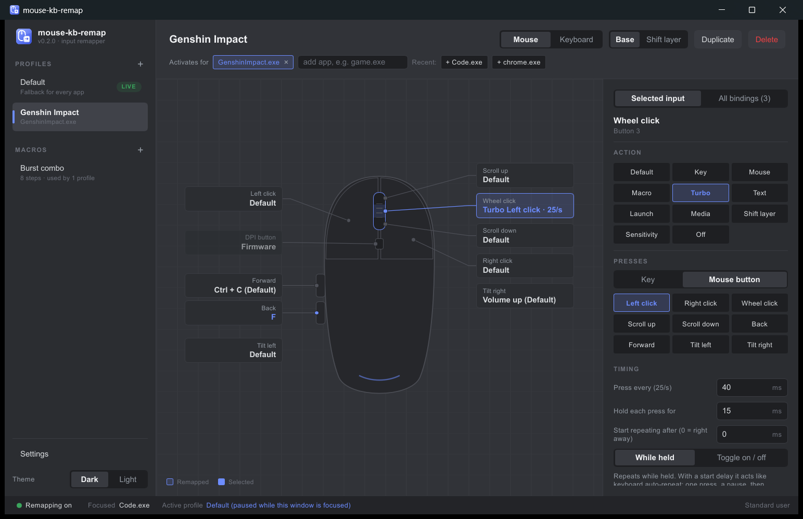

# User guide



The window has four areas:

| Area | Purpose |
| --- | --- |
| **Sidebar** (left) | Your profiles, the **+** button to add one, and the theme switch |
| **Header** (top) | Profile name, which apps activate it, Mouse / Keyboard tabs |
| **Canvas** (center) | A generic mouse or keyboard. Click any button or key to select it. |
| **Inspector** (right) | What the selected input does, plus every binding in this profile |

## Profiles

A profile is a set of bindings. Exactly one profile is active at a time, picked from the
window you're using right now:

1. If the focused window's program (for example `GenshinImpact.exe`) is listed in a
   profile's **Activates for** list, that profile is active.
2. Otherwise **Default** is active.

The active profile is marked **LIVE** in the sidebar and shown in the status bar.

### Inheritance

Bindings in **Default** also apply inside every other profile, unless that profile binds
the same input itself. For example:

| Input | Default | Genshin Impact | Result in Genshin |
| --- | --- | --- | --- |
| Back | `Page Down` | `F` | `F` (the profile's own binding wins) |
| Forward | `Left Ctrl` | *(not bound)* | `Left Ctrl` (inherited) |

When an input in a game profile is unbound, its callout shows the inherited value as
"X (Default)".

### Creating a profile

1. Click **+** next to *PROFILES*.
2. Click the name in the header to rename it.
3. Add the program it should activate for:
   - type the exe name (for example `eldenring.exe`) in the *add app* field and press
     **Enter** (`.exe` is added if you leave it out), or
   - switch to the game once, come back, and click it under **Recent**. The app remembers
     the last few programs you focused.

Matching uses the exe file name only and ignores capitalization. Remove an app with the
**×** on its chip. Delete a profile with **Delete** in the header (Default can't be deleted).

## Remapping an input

1. Choose **Mouse** or **Keyboard** in the header.
2. Click a button or key on the drawing. Clicking a callout box works too.
3. In the inspector, pick an **Action**:

| Action | Effect |
| --- | --- |
| **Default** | No binding in this profile (passes through, or inherits from Default) |
| **Key** | Click the box, then press the key it should send |
| **Mouse** | Pick a mouse button or scroll direction to send |
| **Off** | The input is swallowed and does nothing |

Changes save immediately and apply right away; there's no Save button.

Remapped inputs are outlined in the accent color. On the keyboard, the new key is printed
in the bottom-right corner of the keycap.

### Inputs that can't be remapped

The **DPI button** is drawn for reference only. On almost every mouse it's handled by the
mouse's firmware and never reaches Windows, so no software (other than the vendor's) can
see it. The same is true of some extra buttons on certain mice. If Windows doesn't receive
a button, mouse-kb-remap can't remap it.

### Holding and releasing

A remapped button is held for as long as you hold the physical button, so holding Back
mapped to `W` walks forward. If you switch windows while holding a remapped button,
releasing it still releases the right key.

Scroll up and down are single steps. Mapping a scroll direction to a key taps that key
once per wheel notch.

## Status bar

| Item | Meaning |
| --- | --- |
| ● **Remapping on / paused** | Click to pause or resume all remapping |
| **Focused** | The last program you used other than this one |
| **Active profile** | The profile applied to that program |
| Yellow warning | The focused program runs as admin and this app doesn't, so Windows is blocking remaps. Restart with `start.bat admin`. |
| **Admin / Standard user** | Whether this app itself is elevated |

## Themes

Switch **Dark / Light** at the bottom of the sidebar. The choice is saved.

## Where settings live

Everything is stored in one JSON file:

```
%APPDATA%\mouse-kb-remap\config\config.json
```

You can back it up, sync it between PCs, or edit it by hand. See
[Configuration](configuration.md).
